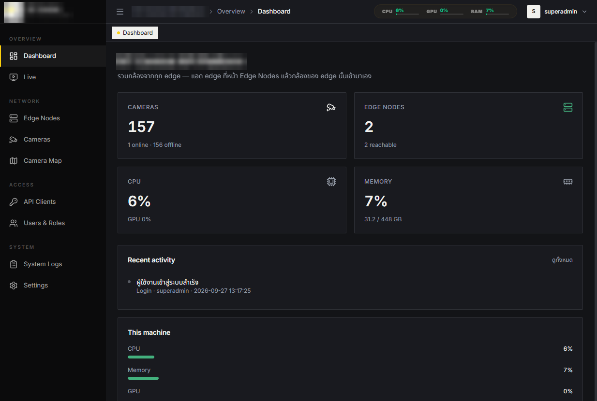
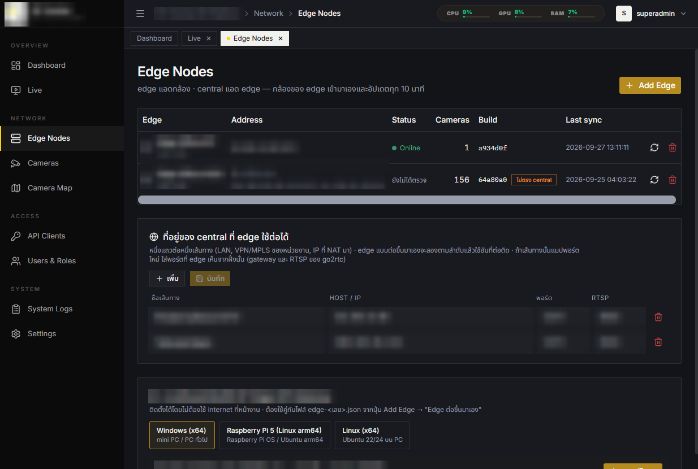

**English** | [ไทย](README.th.md)

# Surveillance Gateway

A LAN-first platform that unifies CCTV cameras from many vendors (ONVIF, NVR, RTSP, VMS) behind one API.
It runs entirely on your own network — no cloud dependency.

> **Status:** portfolio snapshot, updated October 2026. UI is mostly English with some Thai labels; the Windows client ships EN/TH.



## How it works

Three tiers, one codebase:

```text
Cameras / NVRs / VMS  →  Edge (per site)  →  Regional (per region)  →  Central (national)
                                               ↓ API key                 ↓ API key
                                         Regional clients          National clients
```

| Program | Role |
|---|---|
| **Surveillance Gateway Edge** | Adds cameras, holds camera credentials and location data, relays video on request. |
| **Surveillance Gateway Regional** | Adds Edges for a region and issues API keys to clients in that region (keeps working if the Central link drops). |
| **Surveillance Gateway Central** | Adds Regionals, aggregates all cameras, issues national-level API keys. |
| **Surveillance Gateway Client** | Windows (WPF) viewer: video wall, map, camera details, playback. Connects to Central or Regional with an API key. |

Rules enforced by the API: Central adds only Regionals, Regional adds only Edges, Edges add cameras.
Every camera gets a permanent **Global ID** (`TH-<province>-<node>-<seq>`) issued once at the Edge.

## Features

- Live view through [go2rtc](https://github.com/AlexxIT/go2rtc) (H.265 transcoded to H.264, played as fragmented MP4)
- Camera onboarding: manual RTSP, ONVIF camera, ONVIF NVR, vendor API (Uniview LAPI, AXIS S30), VMS (Milestone Open Network Bridge, Dahua DSS Pro)
- Dahua DSS Pro: live main/sub, playback, PTZ and status. One-time stream URLs go through a local RTSP relay. A DSS behind NAT that hands out its LAN address is handled automatically by falling back to the address the DSS was added with.
- Per-camera audio, off by default and enabled at the Edge. Viewers always start muted (web player and Windows client).
- Public cameras: Central can pull public HLS cameras published by government agencies, kept apart from the Edge chain and visible only to API keys that allow them.
- PTZ control, presets, camera map with pins (3D map in the client)
- Playback pulled from the devices themselves (AXIS, Uniview, ONVIF Profile G, Dahua DSS, Hikvision/Dahua drivers) — the system does not record video
- Receives AI events from cameras/NVRs/VMS (e.g. perimeter, line crossing) — no inference in the gateway; see [docs/EXTERNAL-AI.md](docs/EXTERNAL-AI.md)
- Role-based access, API clients with per-group scope, audit log
- Signed (ed25519) Edge updates over a WebSocket "link"
- Offline installer kits for Windows x64, Linux x64 and Raspberry Pi 5, with matching uninstallers. The uninstallers keep the camera data and Global IDs unless asked to remove them.
- Vendor-neutral UI: no brand logo, product names only



## Windows client

A native WPF viewer for operators: connect to Central or Regional with an API key, then work in tabs.

- **Video wall** — 1 / 4 / 9 / 16 / 25 cells, main or sub stream, decoded on the workstation's own GPU
- **3D map** — camera pins on 3D buildings, tiles served by the gateway
- **Camera details, PTZ and playback**; English / Thai UI; automatic updates

| Home | Video wall |
|---|---|
|  |  |
| **Map** | **Camera details** |
|  |  |

See the [user guide](docs/USER-GUIDE.md) and [client notes](client-windows/README.md).

## Stack

Node.js + Express + SQLite (backend) · React + Vite + Tailwind + shadcn/ui (web) · .NET 8 WPF + LibVLC + WebView2 (client) · go2rtc · pm2.

## Repository layout

```
server/        backend (Express + SQLite) — same code runs Central, Regional and Edge
  gateway/     /api/v1 (API key), go2rtc sync, PTZ, global IDs, playback
  vms/         external sources: DSS Pro, AXIS, Uniview, link transport, edge updates
  shared/      instance roles/ports/state, regions, time helpers
src/           React web UI (central / regional / edge entry points)
client-windows/  Windows client (.NET 8 / WPF)
scripts/       deploy, edge kit builders, installers, backup, simulators
docs/          documentation (see below)
```

## Documentation

| Doc | Topic |
|---|---|
| [docs/USER-GUIDE.md](docs/USER-GUIDE.md) | Full user / admin / technical guide with screenshots |
| [docs/CONTRIBUTING.md](docs/CONTRIBUTING.md) | Rules, workflow and pitfalls for changing the code |
| [docs/DESIGN-RATIONALE.md](docs/DESIGN-RATIONALE.md) | Why the system is shaped this way — decisions and history |
| [docs/OPERATIONS.md](docs/OPERATIONS.md) | Restart, deploy, backup, logs, troubleshooting |
| [docs/EDGE-PLAN.md](docs/EDGE-PLAN.md) | Edge ↔ central design and agreements |
| [docs/REGIONAL-PLAN.md](docs/REGIONAL-PLAN.md) | Three-tier architecture |
| [docs/EDGE-KIT.md](docs/EDGE-KIT.md) / [EDGE-LINUX.md](docs/EDGE-LINUX.md) | Installing and updating Edges |
| [docs/CAMERA-QUIRKS.md](docs/CAMERA-QUIRKS.md) | Vendor-specific camera issues (the latest notes and the checklist for adding a new brand / VMS / NVR are in the [Thai version](docs/th/CAMERA-QUIRKS.md)) |
| [docs/CAMERA-AUDIO.md](docs/CAMERA-AUDIO.md) | Per-camera audio (Thai) |
| [docs/PUBLIC-CAMS.md](docs/PUBLIC-CAMS.md) | Public government cameras at Central (Thai) |
| [docs/CLIENT-RELEASES.md](docs/CLIENT-RELEASES.md) | Releasing the Windows client |
| [docs/EXTERNAL-AI.md](docs/EXTERNAL-AI.md) | Receiving AI events from external devices |
| [docs/architecture.html](docs/architecture.html), [pipeline.html](docs/pipeline.html), [workflow.html](docs/workflow.html), [camera-onboarding.html](docs/camera-onboarding.html), [system-flow.html](docs/system-flow.html) | Diagrams (open in a browser) |

## Quick start (development)

```bash
npm install
npm run build        # builds central / regional / edge web apps into dist/
npm run lint
cd server && npm install && node server.js   # default port 5173
```

First login: user `superadmin`, password `superadmin` on a fresh database — **change it immediately**.

Map tiles (`server/map_data/*.mbtiles`, ~880 MB) are not included. Use the online OpenStreetMap source in Settings, or build your own MBTiles (`scripts/build-map-tiles.ps1`).
There is no automated test suite; verification is `node --check`, `npm run lint`, `npm run build` and exercising the API.

## License

MIT — see [LICENSE](LICENSE). Bundled third-party fonts keep their own licenses (SIL OFL, see the `licenses/` folders); go2rtc and other tools you download separately keep theirs.

powered by Warapon Wichitpan
