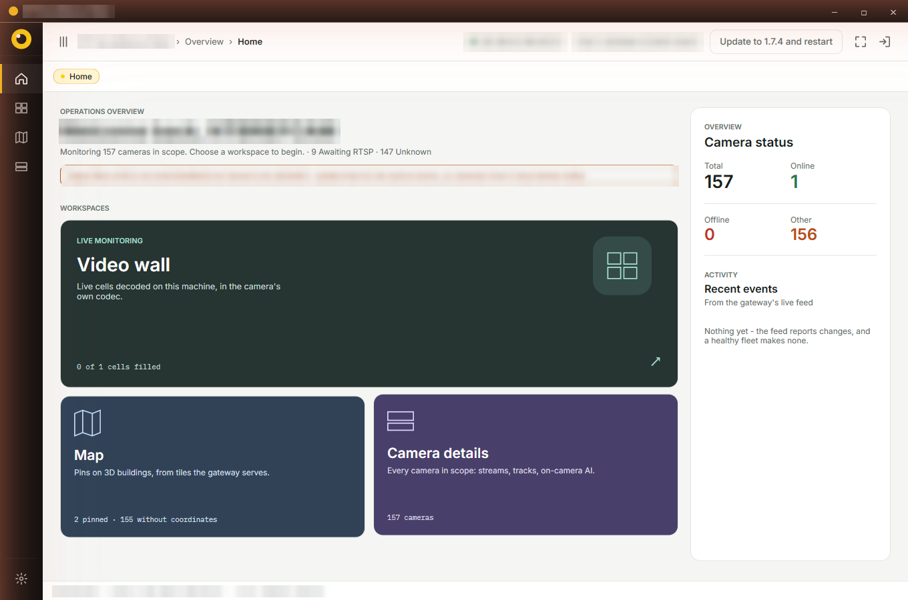
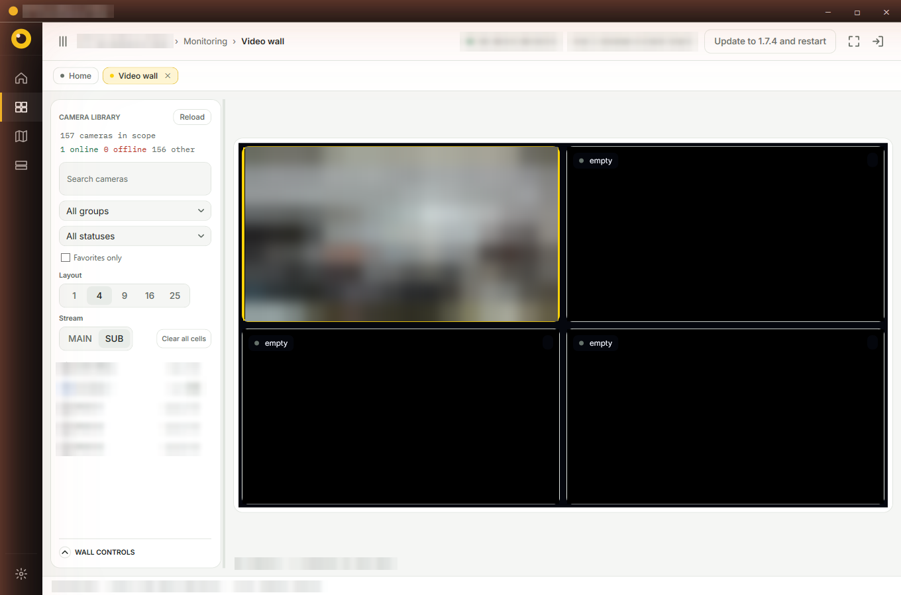
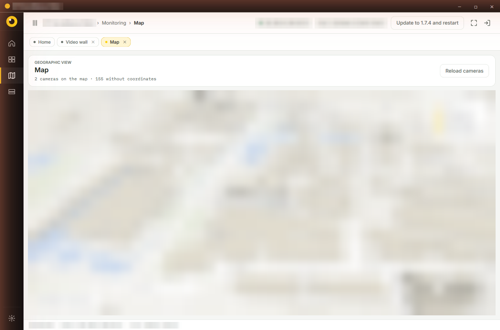
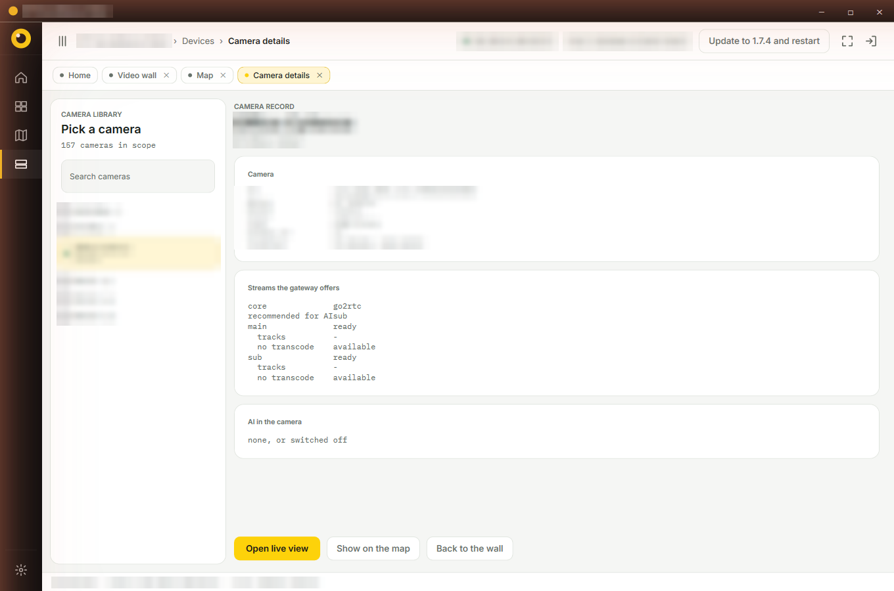

[English](README.md) | **ไทย**

# Surveillance Gateway

ระบบรวมศูนย์ภาพกล้องวงจรปิดหลายยี่ห้อ (ONVIF / NVR / RTSP / Digifort) ให้ระบบอื่นดึงไปใช้ผ่าน API เดียว
ทำงานในวงแลนทั้งหมด ไม่พึ่ง cloud

อัปเดตล่าสุด: 2026-10-02 · ถ้าเอกสารไหนขัดกับไฟล์นี้ ให้ยึดไฟล์นี้ + [../CONTRIBUTING.md](docs/CONTRIBUTING.md)

ระบบจริงใช้ **Central → Regional → Edge** แล้ว · Gateway build `3c273c5` (2026-10-02) · สถานะและผลตรวจอยู่ใน [REGIONAL-PLAN.md](docs/th/REGIONAL-PLAN.md)

## รับ AI จากอุปกรณ์ต้นทาง (2026-10-02)

รับผลจากกล้อง/NVR/VMS/API ภายนอกผ่าน Edge → Regional → Central; ไม่รัน inference ทั้งสามชั้น
เริ่มจาก Tiandy perimeter 203.0.113.12 ที่ Edge 101, Global ID TH-10-101-00001
รองรับ Tiandy Perimeter และ UNV ONVIF LineCrossing พร้อมภาพ; Client 1.9.3 รองรับตัวกรอง Edge/กลุ่ม/ที่มา
ดู [EXTERNAL-AI.md](docs/th/EXTERNAL-AI.md) สำหรับสถานะ/วิธีใช้/ข้อจำกัด

## โปรแกรมและหน้าที่

```text
กล้อง / NVR / VMS → Edge แต่ละไซต์ → Regional ภายในภาค → Central ระดับประเทศ
                                      ↓ API key             ↓ API key
                                  Client ภายในภาค       Client ระดับประเทศ
```

| โปรแกรม | หน้าที่ | ที่อยู่ใช้งานจริง |
|---|---|---|
| Surveillance Gateway Central | เพิ่ม Regional และรวมกล้องทุกภาค; ออก key ระดับประเทศ | `203.0.113.80:5173` / `203.0.113.112:5173` |
| Surveillance Gateway Regional | เพิ่ม Edge ในภาคและออก key ให้ Client ในภาค | ภาคกลาง node `100`: เครื่องเดียวกันพอร์ต `5273` |
| Surveillance Gateway Edge | แอดกล้อง ถือรหัสและข้อมูลพื้นที่; ส่งต่อภาพตามคำขอ | Windows Edge `101` และ Ubuntu Edge `102` (`203.0.113.80:5173`) |
| Surveillance Gateway Client | ดูภาพผ่าน Central หรือ Regional ด้วย API key; บันทึกหลาย Gateway ได้ เลือกใช้ทีละ Gateway | Windows Client `1.9.4`; ดาวน์โหลดจากหน้า login |

**Central เพิ่มได้เฉพาะ Regional · Regional เพิ่มได้เฉพาะ Edge · Edge เพิ่มกล้อง** — บังคับที่ API ด้วย
จังหวัดเดียวติดตั้งหลาย Edge ได้ ระบุที่ตั้งด้วย Remark; ไม่มี Sub-edge และไม่ใช้ IP เป็นตัวระบุกล้องข้ามไซต์
ทุกครั้งที่แอดกล้องต้องเลือกจังหวัดและอำเภอ/เขต; แก้พื้นที่ทั้งกลุ่มหรือกล้องที่เลือกได้ที่ Edge โดย Global ID และพิกัดคงเดิม
Regional ออก key ของตัวเองเพื่อให้ Client ชี้ Regional โดยตรงเมื่อสายไป Central ขาด; Client ยังไม่สลับ Gateway อัตโนมัติ
Milestone Bridge Playback ยืนยันกับบันทึกจริง AXIS/TIANDY ผ่านทั้ง Regional และ Central แล้ว (2026-09-30); ไม่ต้องแอดกล้องใหม่
ไม่รัน inference; รับ AI จากต้นทางที่เปิดไว้ใน AI Sources และระบบไม่บันทึกวิดีโอเอง

client มีหน้า Playback ตั้งแต่ 1.8.3 (1.8.4 เปลี่ยนเป็นเส้นเวลาแบบ VMS · ต้องเปิดสิทธิ์ `allow_playback` ให้ API key)
แหล่งภาพย้อนหลัง: **AXIS S30 และ Uniview NVR ใช้งานจริงแล้ว** · ONVIF Profile G ใช้ได้กับกล้อง Tiandy ที่มี SD card (ทดสอบ 2026-09-29)
· Hikvision / Dahua / Profile G ของ NVR ยี่ห้ออื่นและ Milestone เขียนแล้ว **รอทดสอบกับเครื่องจริง** · Digifort ตอบ 501 รอเอกสาร API
· **Dahua DSS Pro (VMS)** แอดที่ edge ได้ครบ: ภาพสด main/sub, ย้อนหลัง, PTZ, สถานะ (ทดสอบกับ DSS Pro V8.5.0 เมื่อ 2026-09-29)


## พอร์ตและโปรเซส

| พอร์ต | ของ | pm2 app |
|---|---|---|
| 5173 | Central — เว็บ + `/api/*` + `/api/v1` + proxy วิดีโอ | `2-vms-backend` |
| 1984 / 8555 / 8556 | go2rtc ของ central — API (127.0.0.1 เท่านั้น) / RTSP / WebRTC | `0-go2rtc` |
| 5273 | Regional ภาคกลาง — เว็บ + API | `3-regional-gateway` |
| 1994 / 8565 / 8566 | go2rtc ของ Regional (API 127.0.0.1 เท่านั้น) | `1-go2rtc-regional` |


## Windows client

โปรแกรมดูกล้องสำหรับผู้ปฏิบัติงาน (WPF) ต่อ Central หรือ Regional ด้วย API key

- **Video wall** 1 / 4 / 9 / 16 / 25 ช่อง เลือก main/sub ถอดรหัสด้วย GPU ของเครื่องเอง
- **แผนที่ 3 มิติ** ปักหมุดกล้องบนอาคาร 3 มิติ
- รายละเอียดกล้อง, PTZ, ภาพย้อนหลัง, UI ไทย/อังกฤษ, อัปเดตอัตโนมัติ

| หน้าแรก | Video wall |
|---|---|
|  |  |
| **แผนที่** | **รายละเอียดกล้อง** |
|  |  |

ดู [คู่มือ](docs/USER-GUIDE.md) และ [บันทึกของ client](client-windows/README.th.md)

## โครง repo

```
server/                 backend (Node.js + Express + SQLite) — ตัวเดียวกันทั้ง central และ edge
  server.js             route หลักทั้งหมด (/api/*)
  gateway/              /api/v1 (API key), go2rtc sync, PTZ, global ID, ดูย้อนหลัง (playback.js),
                        ค่า AI ของ edge (ai-config.js) · analytics/ = โค้ด AI หัวกล้องที่ไม่ได้ต่อเข้าระบบ
  vms/                  แหล่งกล้องภายนอก: Digifort, AXIS S30, Uniview NVR, สาย link, แจ้งเตือน edge หลุด
  shared/               instance.js (บทบาท/พอร์ต/state), regions.js (จังหวัด), time.js, ai-events.js
  data/                 thai-regions.csv — รหัสจังหวัด/อำเภอ/ตำบล
src/                    หน้าเว็บ React (build ได้สองแอป)
  main.jsx / edge-main.jsx   entry ของ central / edge
  lib/app-config.js     ชื่อ + เมนูของแต่ละแอป
  components/shell/     โครงหน้าจอ (sidebar, breadcrumb, tabs)
index.html / edge.html  หน้าเว็บของ central / edge
client-windows/         Windows client (.NET 8 / WPF)
go2rtc/                 go2rtc.exe + config ของ central
scripts/                build client, ชุดติดตั้ง edge (build-edge-kit.ps1, edge-kit/, edge-run.cjs), reset, backup, sim
docs/                   เอกสาร (ดูด้านล่าง) · docs/reference/ = เอกสารต้นทาง (V.3 Platform, WebAPI ของกล้อง)
ecosystem.windows.config.cjs   pm2 ของ central
ecosystem.edge.config.cjs      pm2 ของ edge
```

## เอกสาร

| ไฟล์ | อ่านเมื่อ |
|---|---|
| [../CONTRIBUTING.md](docs/CONTRIBUTING.md) | **ก่อนแก้โค้ดทุกครั้ง** — กติกา, workflow, กับดักที่เคยเจอ |
| [../DESIGN-RATIONALE.md](docs/DESIGN-RATIONALE.md) | อยากรู้ว่าทำไมระบบเป็นแบบนี้ — ประวัติและการตัดสินใจ |
| [docs/OPERATIONS.md](docs/th/OPERATIONS.md) | restart, deploy, backup, reset, ดู log, แก้ปัญหา |
| [docs/EDGE-PLAN.md](docs/th/EDGE-PLAN.md) | ระบบ edge ↔ central: การทำงาน, ข้อตกลง, งานที่เหลือ |
| [docs/EDGE-KIT.md](docs/th/EDGE-KIT.md) | **edge ใหม่**: ชุดติดตั้ง offline (Windows x64 / Raspberry Pi 5 / Linux x64) ดาวน์โหลดจากหน้า Edge Nodes + ไฟล์ edge-<เลข>.json · อัปเดต edge ผ่านสาย link (เซ็น ed25519, กดติดตั้งที่ edge, ถอยกลับเอง) |
| [docs/EDGE-LINUX.md](docs/th/EDGE-LINUX.md) | ตั้ง edge บน Linux (Ubuntu 24) แบบเดิม: ติดตั้งเอง, systemd, backup, ต่อ central |
| [docs/CAMERA-QUIRKS.md](docs/th/CAMERA-QUIRKS.md) | กล้องไม่มีภาพ/ภาพแปลก — ปัญหาเฉพาะยี่ห้อที่เจอแล้ว |
| [docs/CLIENT-RELEASES.md](docs/th/CLIENT-RELEASES.md) | ปล่อยเวอร์ชันใหม่ของ Windows client |
| [client-windows/README.md](client-windows/README.th.md) | โครงสร้างและการทำงานของ client |
| [server/data/README.md](server/data/README.md) | ที่มาและ license ของข้อมูลจังหวัด |
| [docs/manual/](docs/USER-GUIDE.md) | **คู่มือระบบฉบับเต็ม** (.docx / .pdf พร้อมภาพหน้าจอจริง) · สร้างใหม่ด้วยสคริปต์ใน `docs/manual/src/` |

[docs/camera-onboarding.html](docs/camera-onboarding.html) อธิบายหลังบ้านการแอดกล้องแต่ละแบบ (ONVIF / NVR / API / VMS / RTSP) · ไฟล์ `.html` อื่นใน `docs/` (architecture, pipeline, workflow ฯลฯ) และไฟล์ PDF แผน V.3 เป็น **เอกสารประกอบการนำเสนอช่วงก่อนหน้า**
บางส่วนยังอธิบายระบบยุค VMS/AI — ใช้อ้างอิงแนวคิด ไม่ใช่สถานะปัจจุบัน

## เริ่มทำงานเร็ว ๆ

```bash
npm install                      # dependency ของหน้าเว็บ (ครั้งแรก)
npm run build                    # build หน้าเว็บทั้งสองแอปลง dist/ — ทั้ง central และ edge ใช้ dist เดียวกัน
npm run lint                     # ESLint
```

deploy (backup → restart → ตรวจ build → build เว็บ → publish ให้ edge แบบ link) ใช้คำสั่งเดียวจาก PowerShell แบบ **Run as administrator**
(`-ReloadEdgeConfig` เมื่อแก้ edge.json หรือ ecosystem ของ edge · `-ReleaseClient` เมื่อขึ้นเวอร์ชัน client):

```bash
powershell -ExecutionPolicy Bypass -File D:\gateway-dashboard\scripts\deploy.ps1
```

restart อย่างเดียว (pm2 ตัวเดียวกับ task บูต — รายละเอียดใน [docs/OPERATIONS.md](docs/th/OPERATIONS.md)):

```powershell
$env:PM2_HOME = "D:\gw-pm2\home"; & "C:\Program Files\nodejs\node.exe" "D:\gw-pm2\npm\node_modules\pm2\bin\pm2" restart 2-vms-backend 3-regional-gateway
```

ไม่มี test suite อัตโนมัติ — ตรวจด้วย `node --check`, `npm run lint`, `npm run build` และลองเรียก API จริง
(หรือใช้ edge/central จำลอง `scripts/edge-sim.ps1`)

## ใช้งานครั้งแรก

1. เปิดหน้า Edge เครื่องที่รับกล้อง (Ubuntu node `102`: `http://203.0.113.80:5173`) → login `superadmin` / `superadmin` (DB ใหม่) → **เปลี่ยนรหัสทันที**
2. Edge → **Cameras** → Add Camera (ONVIF / NVR / API / RTSP / VMS) → เลือกจังหวัด/อำเภอ
   - **API** → เลือกผู้ให้บริการ (ปัจจุบันรองรับ Uniview LAPI) อ่านชื่อและสถานะช่อง แล้วจับคู่ RTSP ที่ ONVIF คืนมาด้วยเลขช่องจริง · ช่อง offline เพิ่มเป็นแถวรอภาพได้ Edge ตรวจ ONVIF ซ้ำทุก 2 นาทีและเติม RTSP ในแถวเดิมเมื่อพบ
   - **VMS** → เลือก Milestone Open Network Bridge เพื่อสแกน ONVIF และนำเข้า RTSP ที่ Bridge คืนมา; กรอกที่อยู่และบัญชีของแต่ละระบบเอง ดูข้อสังเกตเรื่อง H.265/TCP ใน [docs/CAMERA-QUIRKS.md](docs/th/CAMERA-QUIRKS.md)
3. Regional `http://203.0.113.80:5273` → **Edge Nodes** → Add Edge → เลือกจังหวัด ใส่ Remark และออก token/config ให้ Edge ต่อขึ้น Regional
4. Central `http://203.0.113.80:5173` → **Regional Nodes** → Add Regional → ออก token/config ให้ Regional ต่อขึ้น Central; กางแถว Regional เพื่อดู Edge ลูก
5. Central → **API Clients** → ออก key ให้ Windows client → เปิด client แล้วใส่ key

credit **"powered by Warapon Wichitpan"** ต้องคงไว้ทุกที่ที่มีอยู่

## สัญญาอนุญาต

MIT — ดู [LICENSE](LICENSE)
