# Surveillance Gateway User Guide

A guide for users, administrators and technical staff of Surveillance Gateway, a three-tier CCTV gateway.

Screenshots were taken from a live system on 27 Sep 2026 (Central build a934d0f, Client 1.7.2 and 1.7.4). Edge 002 was offline at the time, so the online-camera counts in the images are lower than normal. Some screenshots show the Thai UI; the English meaning of Thai labels is given in parentheses in the text. Example addresses in this guide use the documentation range `203.0.113.x`: Central is `203.0.113.10` (VPN address `203.0.113.11`). Replace them with your own.

## Table of contents

- [Chapter 1. System overview](#chapter-1-system-overview)
  - [1.1 What this system is](#11-what-this-system-is)
  - [1.2 The three programs](#12-the-three-programs)
  - [1.3 Key principle: the Edge adds cameras, Central adds Edges](#13-key-principle-the-edge-adds-cameras-central-adds-edges)
  - [1.4 The path of the video](#14-the-path-of-the-video)
  - [1.5 Architecture](#15-architecture)
  - [1.6 Terms to know](#16-terms-to-know)
- [Part 1. Users](#part-1-users)
  - [Chapter 2. Surveillance Gateway Client](#chapter-2-surveillance-gateway-client)
  - [Chapter 3. The Central web UI for viewers](#chapter-3-the-central-web-ui-for-viewers)
- [Part 2. Administrators](#part-2-administrators)
  - [Chapter 4. Surveillance Gateway Edge](#chapter-4-surveillance-gateway-edge)
  - [Chapter 5. Surveillance Gateway Central](#chapter-5-surveillance-gateway-central)
  - [Chapter 6. Installing a new Edge from a flash-drive kit](#chapter-6-installing-a-new-edge-from-a-flash-drive-kit)
- [Part 3. Technical](#part-3-technical)
  - [Chapter 7. How it works](#chapter-7-how-it-works)
  - [Chapter 8. Backend and operations](#chapter-8-backend-and-operations)
  - [Chapter 9. Security](#chapter-9-security)
  - [Chapter 10. Backup and restore](#chapter-10-backup-and-restore)
  - [Chapter 11. Troubleshooting](#chapter-11-troubleshooting)
- [Appendices](#appendices)

---

# Chapter 1. System overview

## 1.1 What this system is

Surveillance Gateway brings CCTV video from many camera brands and many organizations (ONVIF, NVR, RTSP, Uniview API and VMS) behind a single entry point. Users and other systems fetch video and camera data through one API using an API key, without ever needing to know the cameras' passwords.

The whole system runs on the LAN and a VPN (Tailscale). It does not depend on the cloud and does not need Internet access at the site.

## 1.2 The three programs

| Program | Role | Address |
|---|---|---|
| **Surveillance Gateway Edge** (Edge) | Adds cameras on its own LAN, holds the camera passwords, and passes video to Central untouched (passthrough). | Edge 001: `http://203.0.113.10:5273` · Edge installed from the kit: `http://<IP>:5173` |
| **Surveillance Gateway Central** (Central) | Adds Edges and receives all of their cameras · issues API keys to clients and external systems · transcodes only the video that browsers need. | `http://203.0.113.10:5173` · VPN `203.0.113.11:5173` |
| **Surveillance Gateway Client** (Windows) | The viewing program for users: video wall, map and PTZ. Decodes H.265 on the user's own GPU. | Download from the Central login page · latest version 1.7.4 |

## 1.3 Key principle: the Edge adds cameras, Central adds Edges

- The **Edge** sits close to the cameras (same LAN). It is the only place that stores camera passwords, and it owns the camera name, coordinates, province and global ID.
- **Central** does not add cameras itself (the API answers 403). It receives all cameras through Edges and holds only each Edge's API key.
- Heavy video flows only while someone is watching. No viewer means no video is pulled from the camera and no bandwidth is used.
- The Edge does not transcode, so it can run on a small machine with no GPU (a mini PC or a Raspberry Pi 5). Transcoding happens only at Central, and only for streams that browsers need.
- Edge and Central are the same code base. They differ only in the `GATEWAY_ROLE` setting.

## 1.4 The path of the video

One frame travels from the camera to the viewer's screen in 6 steps. Steps 1 to 3 happen at the Edge; steps 4 to 6 happen at Central and on the viewer's machine.

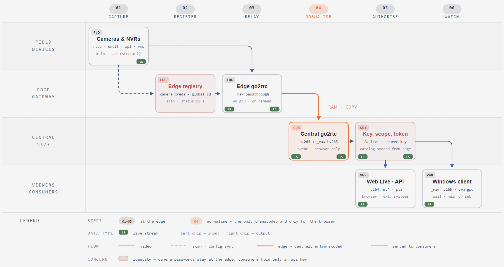

1. **Capture**: the camera or NVR sends the main (stream 1) and sub (stream 2) video over RTSP.
2. **Register**: the Edge registers the camera, holds its password, issues the global ID and checks its status every 15 seconds.
3. **Relay**: the Edge's go2rtc sends the `_raw` stream to Central without conversion.
4. **Normalise**: Central's go2rtc produces an H.264 stream for browsers and keeps the `_raw` stream for the Windows Client.
5. **Authorise**: the viewer needs an API key and receives a stream token valid for 5 minutes per stream.
6. **Watch**: the browser plays H.264, while the Windows Client plays the camera's original H.265 using its own GPU.

## 1.5 Architecture

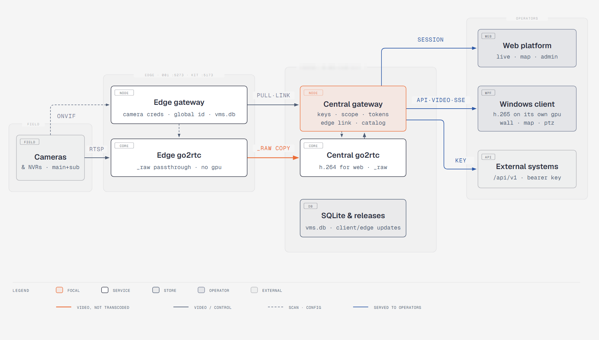

An Edge connects to Central in one of two ways. **Pull**: Central connects into the Edge with an API key issued by the Edge; use this when Central can reach the Edge. **Link**: the Edge opens a WebSocket up to Central itself; use this for Edges behind NAT that Central cannot reach.

## 1.6 Terms to know

| Term | Meaning |
|---|---|
| main / sub | The camera's high-resolution stream (stream 1) and low-resolution stream (stream 2). The system does not use stream 3 or higher. The Live page and the video wall mainly use sub. |
| `_raw` | A stream that forwards the camera's original codec (mostly H.265) with no transcoding. |
| global ID | A nationwide camera ID in the form `TH-<2-digit province>-<3-digit Edge number>-<5-digit sequence>`. It is issued once at the Edge and never changes for the life of the camera. |
| Edge number (node) | A machine number that is unique across the whole deployment. Central = 000, the Edge on the Central machine = 001, the next real Edge = 002, and so on. |
| Three-valued status | **enabled**: did the administrator enable the camera? · **reachable**: does the camera answer? · **streaming**: is video currently being pulled? |
| API key | A key of the form `sgw_…` that Central issues to a client or external system, bound to a camera-group scope and a PTZ permission. |
| stream token | A 5-minute ticket bound to a single stream, used to open video through `/stream/<name>.mp4`. |

---

# Part 1. Users

# Chapter 2. Surveillance Gateway Client

The Surveillance Gateway Client is a Windows viewing program, well suited to video-wall screens and control rooms because it decodes H.265 on the user's own GPU and puts no load on the server.

## 2.1 Install the program

1. Open the Central login page `http://203.0.113.10:5173` and press the program download button, or open `http://203.0.113.10:5173/client-updates/SurveillanceGateway-win-Setup.exe` directly.
2. Run `SurveillanceGateway-win-Setup.exe`. No admin rights are needed. The program is installed at `%LOCALAPPDATA%\SurveillanceGateway`.
3. The machine needs the WebView2 runtime (already present on Windows 11 and Windows Server 2022).

> **Note:** The Portable file (`SurveillanceGateway-win-Portable.zip`) can be used on machines where installation is not possible, but it cannot update itself.

## 2.2 Connect to Central with an API key

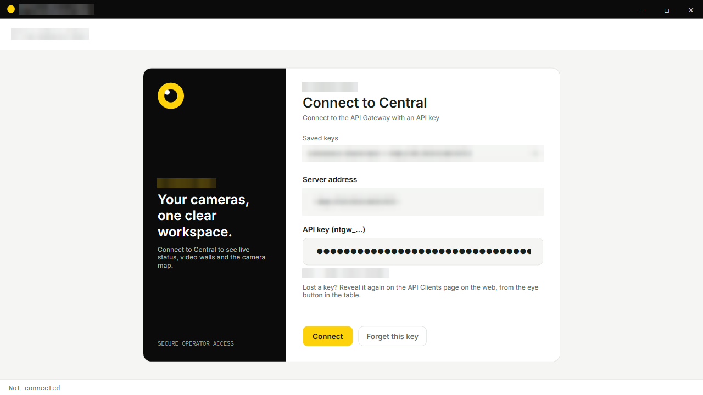

1. Get an API key from the system administrator (issued on Central's API Clients page, see Chapter 5).
2. In the **Server address** field enter `http://203.0.113.10:5173` (outside the LAN use the VPN address).
3. In the **API key** field paste the key you received and press **Connect**. The program checks the address first and then the key, so it can tell you which part is wrong.
4. A key that works is remembered in the **Saved keys** list (encrypted with Windows DPAPI). Next time, pick it from the list and press Connect.

The **Forget this key** button removes the remembered key from the machine. The sign-out button at the top right only disconnects; it does not delete the key.

## 2.3 Home page

- **Camera status** on the right: Total / Online / Offline / Other (Other includes cameras whose Edge cannot be reached, cameras waiting for RTSP, and disabled cameras).
- **Workspaces**: the Video wall, Map and Camera details cards. Click one to open that page as a tab.
- A red banner appears when an Edge's build does not match Central's (in the example image the Edge "Office AXIS" is still on an old build). Tell the administrator to update the Edge.
- The **Update to x.y.z and restart** button appears when a new version is available. The program has already downloaded it in the background; press it when you are ready for the picture to go dark briefly.
- The bottom bar shows the connection status, for example `Connected - http://203.0.113.10:5173 · live camera status`.

## 2.4 Video wall

- **Camera library** on the left: search cameras and filter by group, status and favorites.
- **Layout**: 1 / 4 / 9 / 16 / 25 cells.
- **Stream**: choose MAIN or SUB for the whole layout (SUB is recommended for many cells) · **Clear all cells** empties every cell.
- Each camera group shows online/total, for example `1/1`. Press the ▶ button at the end of a group to play the whole group into the layout.
- Click a cell to select it, then click a camera in the list to put it in that cell · right-click a cell to open the cell menu.
- Each cell shows the camera name, a status dot and the fps in its corner · **Wall Controls** at the bottom saves and recalls arranged layouts (saved views) and sets automatic page cycling.

## 2.5 Enlarge the picture and PTZ

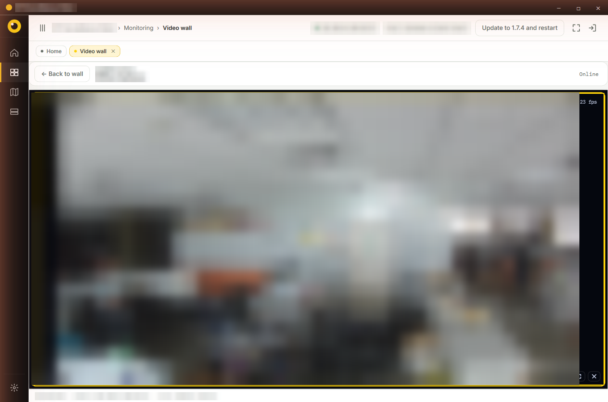

Double-click a cell to enlarge it. Press Esc or **Back to wall** to return. If the camera can pan/tilt and the key has the PTZ permission, the PTZ panel is shown beside the picture (hold the arrows to move, plus zoom and presets).

> **Note:** The key in the sample image (`windows-client-test`) does not have the "control PTZ" permission ticked on the API Clients page, so the PTZ panel is not shown. Cameras that come from an Edge need PTZ permission at two levels: the client's key at Central, and the key Central holds with the Edge.

## 2.6 Map

The map shows only cameras that have been pinned (the bottom-left corner shows how many cameras still have no coordinates). Click a pin to view the camera. The Layers control toggles 3D buildings, street names and points of interest. Pinning is done only on the Edge's Map Pins page.

## 2.7 Camera details

Shows the camera information (id, group, brand, type, coordinates), the streams Central provides (main/sub and the non-transcoded stream), and the camera-side AI (currently off). Buttons at the bottom: **Open live view** opens a separate picture window (which can be dragged to another screen), **Show on the map** and **Back to the wall**.

## 2.8 Settings

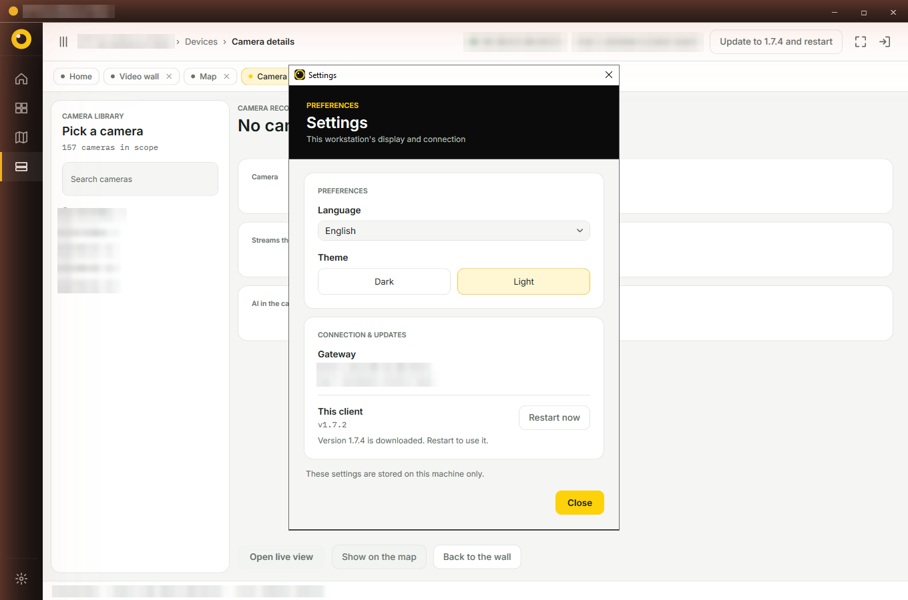

- **Language**: English / Thai, switchable while in use.
- **Theme**: Dark / Light.
- **Connection & updates** shows the gateway and key in use, the program version, and a **Restart now** button when a new version is available.

## 2.9 Full screen, updates and exiting

- **F11** or the full-screen button at the top right: hides the top bar and expands the window over the real screen edges, including the taskbar. Press F11 again to restore the previous size.
- **Updates**: the program does not restart by itself, because on a wall screen the picture would go dark in the middle of a shift. The user presses the update button when ready. **Do not kill the program while an update is being installed.**
- **Exiting** (since 1.7.4): the ✕ button, Alt+F4 or closing from the taskbar shows a confirmation box. Press Exit to leave, or Cancel/Esc to keep working.

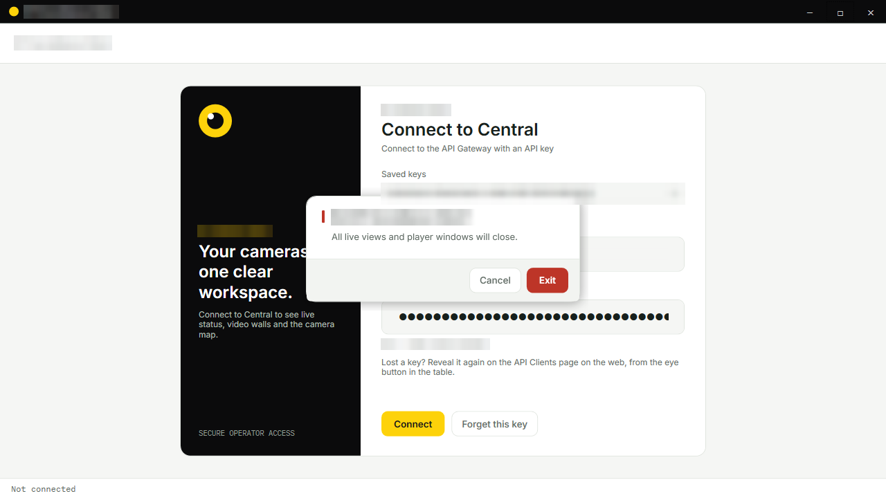

## 2.10 What the camera statuses mean

| Status | Meaning | What to do |
|---|---|---|
| Online (green) | The Edge can reach the camera. | None |
| Offline (red) | The Edge cannot reach the camera, for example a power cut or a loose cable. | Tell the on-site administrator. |
| Edge unreachable (grey) | Central cannot reach the Edge that manages this camera, so the camera's real status is unknown. | This does not mean the camera is down. Check the Edge's network. |
| Waiting for RTSP | An NVR channel that was added while offline and has no video address yet. | Wait for the Edge to fill it in, or re-scan the NVR when the channel is back. |
| Disabled | The administrator disabled the camera at the Edge. | None |

---

# Chapter 3. The Central web UI for viewers

The Central web UI lets you watch live video without installing a program. It suits temporary viewing or non-Windows machines. Every cell on the web is H.264 video that Central transcodes.

## 3.1 Sign in and the Dashboard

Open `http://203.0.113.10:5173` and sign in with the account the administrator created. The menu you see depends on the account's role.

The Dashboard shows the total camera count (online/offline), the number of reachable Edges, the machine's CPU/GPU/memory, and recent activity.

## 3.2 Live

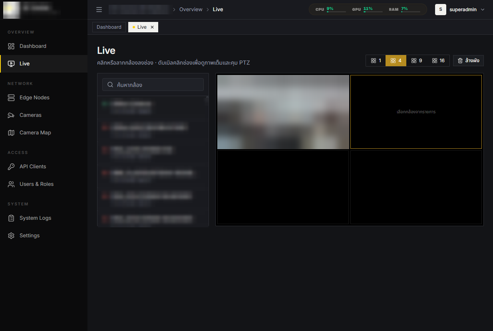

1. Choose a 1 / 4 / 9 / 16 cell layout at the top right.
2. Click the cell you want (yellow border), then click a camera in the list on the left. You can search by name or global ID.
3. Double-click a cell to see the full picture with the PTZ panel (requires the `device.ptz` permission).

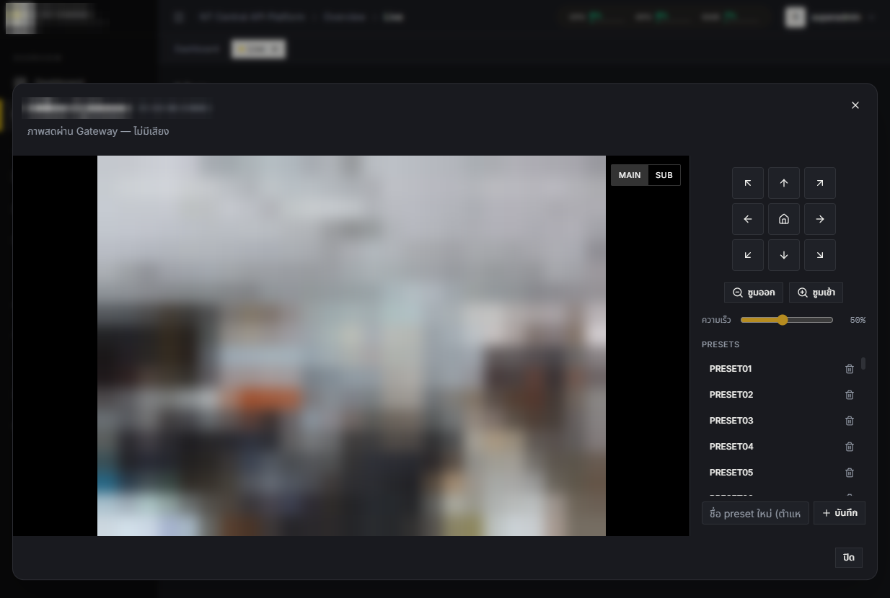

In the full-picture view you can choose MAIN/SUB. The PTZ panel has direction buttons, zoom in/out, speed, and a preset list (save or recall stored positions).

## 3.3 Camera Map

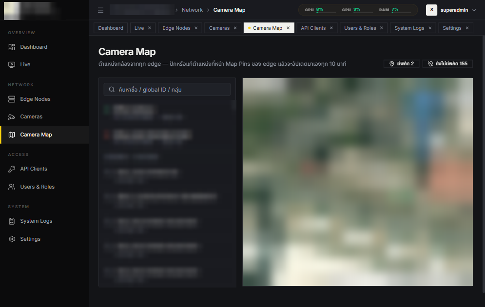

Shows camera positions from all Edges, switchable between map and satellite. The list on the left separates cameras that have coordinates from those not yet pinned. Pinning or correcting a position is done on the Edge's Map Pins page; Central then updates itself within 10 minutes.

---

# Part 2. Administrators

# Chapter 4. Surveillance Gateway Edge

The Edge web UI is configuration only; there is no video viewing page. It is used to add cameras, pin them on the map, and issue keys to Central. Edge 001 is at `http://203.0.113.10:5273`, and an Edge installed from the flash-drive kit is at `http://<Edge IP>:5173`.

> **Important:** A newly installed Edge signs in for the first time with `superadmin` / `superadmin`. Change the password immediately on the Users & Roles page.

## 4.1 Edge Dashboard

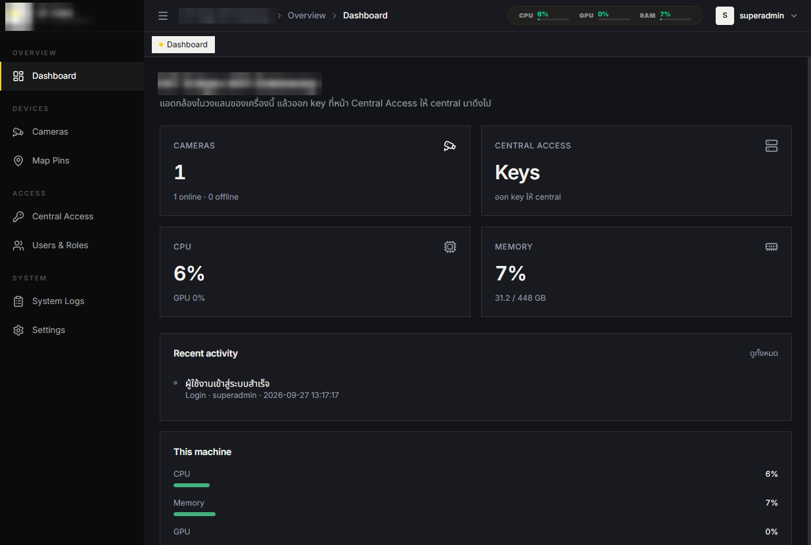

Shows this Edge's camera count (online/offline), a link to the Central Access page, and the machine's resources.

## 4.2 Camera list

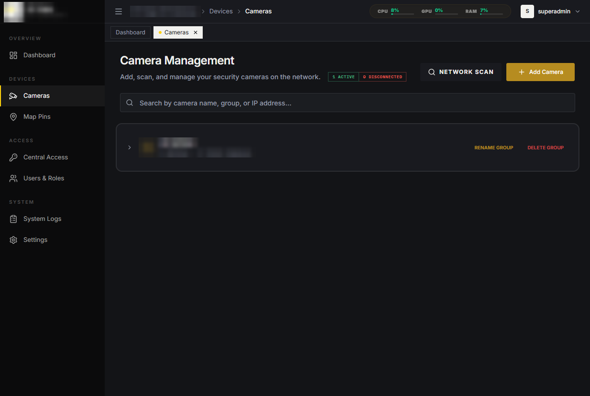

Cameras are organized into groups. Click a group name to expand its list. Each camera has buttons to enable/disable, edit and delete · the **Network Scan** button looks for ONVIF devices on the network · the **Add Camera** button opens the add-camera form.

Disabling a camera (enabled = off) makes the system stop pulling its video, stop checking its status and stop counting it as down. Central and the Client show the status "Disabled" accordingly.

## 4.3 Five ways to add a camera

| Type | Use when | main / sub |
|---|---|---|
| Manual RTSP | You already know the camera's RTSP URL. | main = the URL entered · sub = the "RTSP Sub Stream URL" field (blank = same stream as main) |
| ONVIF Camera | A single camera that supports ONVIF. | The system queries ONVIF itself: main = the highest-resolution profile, sub = stream 2 · if the camera has only one profile, the RTSP sub field you fill in is used |
| ONVIF NVR | A multi-channel NVR; scan, then choose the channels to import. | Per channel: main = stream 1, sub = stream 2 |
| API (Uniview LAPI) | A Uniview NVR where you want the real channel names from the NVR and want to add channels that are still offline. | Reads channel names from LAPI and matches RTSP from ONVIF by channel number · offline channels become "Waiting for RTSP" rows |
| VMS (Digifort) | Cameras behind a VMS. | main = the VMS relay · no sub |

Every way of adding a camera requires a province and a matching district.

### Manual RTSP

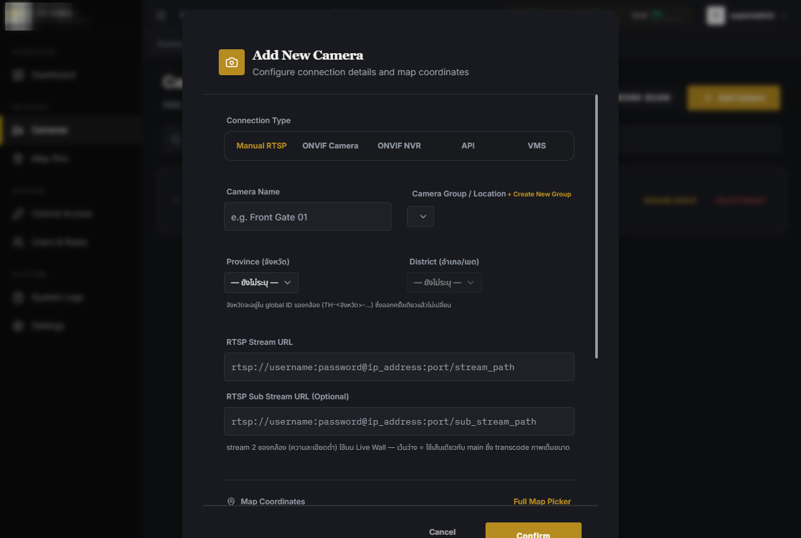

1. Name the camera and choose a group (create a new group with "+ Create New Group").
2. Choose the province and district. The province goes into the global ID, which is issued once and never changes.
3. Enter the **RTSP Stream URL** (main) and the **RTSP Sub Stream URL** (stream 2, if any).
4. You can pin the coordinates under Map Coordinates, or leave them blank and pin later on the Map Pins page.
5. Press **Confirm**.

### ONVIF Camera

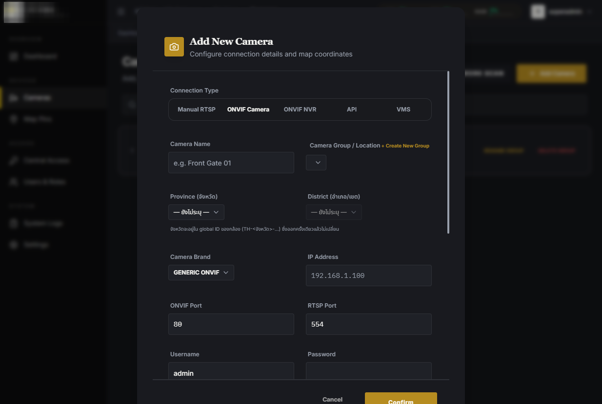

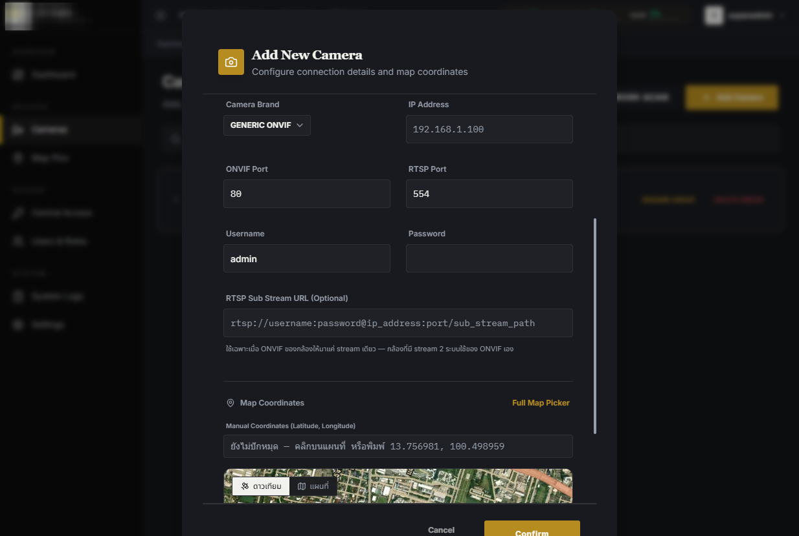

Enter the brand, IP, ONVIF port (normally 80), RTSP port (normally 554) and the ONVIF account. The system queries the profiles from the camera itself and picks main/sub. If the camera does not answer ONVIF, the system uses a URL pattern based on the brand instead.

> **Note:** An Axis camera needs a separate ONVIF account created in the camera (System → Accounts → ONVIF accounts). The web root account cannot be used for ONVIF.

### ONVIF NVR

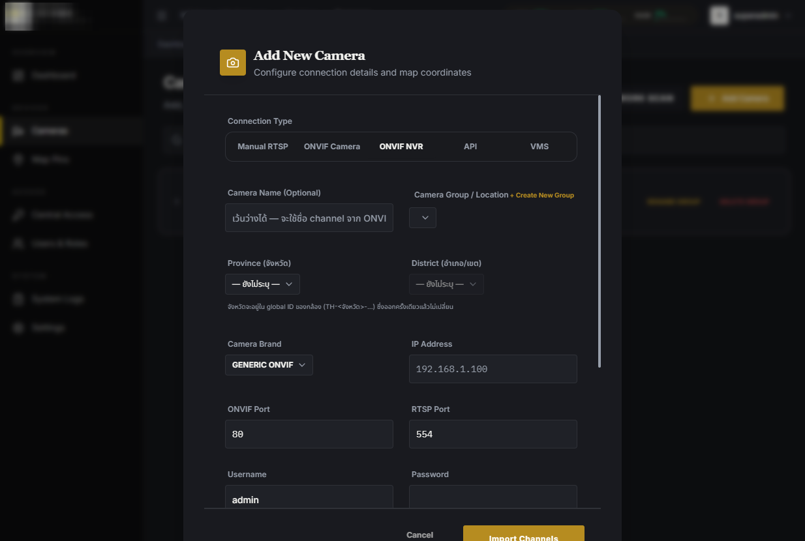

1. Enter the NVR's IP, port and account and press scan. The system lists the channels with their online/offline status and resolution.
2. A channel that has already been added carries an "Added" badge and cannot be selected again (no duplicate rows).
3. Select the channels you want and press **Import Channels**. The camera name can be left blank; the system uses the channel name from ONVIF.

**Re-scanning the same NVR** is useful for two things: picking up channels that were offline during the previous scan, and updating the sub stream of already-added channels to stream 2 according to the current rule (the system does not touch main).

### API (Uniview)

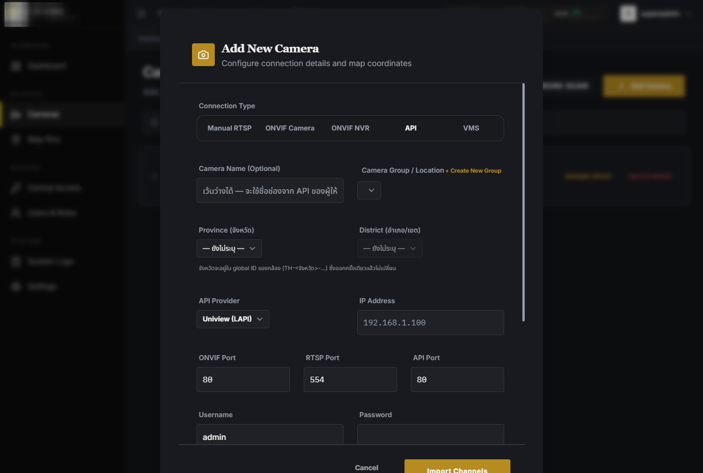

Enter the IP, ONVIF port, API port and account of the Uniview NVR. The system reads the channel names and status from LAPI and matches RTSP from ONVIF by real channel number. Offline channels can be imported as "Waiting for RTSP" rows. The Edge re-checks ONVIF every 2 minutes and fills in RTSP by itself when a channel comes back.

### VMS (Digifort)

Enter the Digifort address and account, then import cameras several at a time. Cameras from a VMS can only have their name, group and pin edited, because the video address is a relay the system creates itself, and there is no sub stream.

## 4.4 main / sub rules and picture quality

- The system uses stream 1 as main and stream 2 as sub only. It does not use stream 3.
- The Live page and the video wall use sub. Set the camera's sub to roughly 640×360 up to 704×576, at 15–25 fps.
- Set the **I-frame interval ≈ fps** (a keyframe every 1–2 seconds). If it is longer, the picture appears tens of seconds late, because a player can only start displaying at the first keyframe.
- Cameras added before 25 Sep 2026 may still use stream 3: for a single camera, open it for editing and press save; for NVR channels, re-scan the NVR.

## 4.5 Map Pins

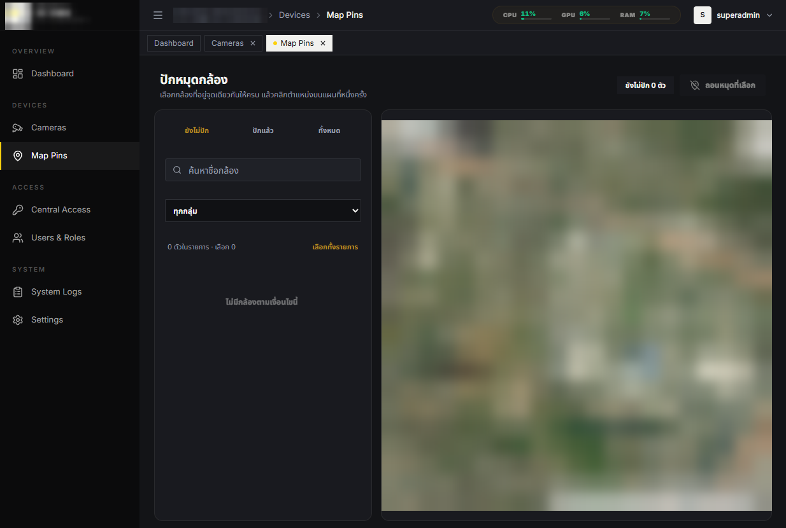

Pin or correct a camera's position on the map or satellite imagery. Choose the camera from the list and click on the map. Cameras added through an NVR/VMS never have coordinates at first and must be pinned on this page. Central cannot pin (it answers 403) and picks up the new position on the next sync round.

## 4.6 Central Access

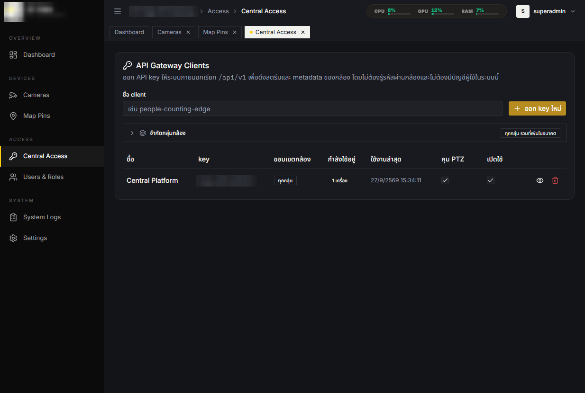

Used for the pull connection: name the client (for example Central Platform) and press **Issue new key** (the Thai UI label is "ออก key ใหม่"). Copy the key into Central's Edge Nodes page. Tick **Control PTZ** (Thai UI "คุม PTZ") if Central should be allowed to move this Edge's cameras. The "In use" column (Thai UI "กำลังใช้อยู่") shows how many machines are using the key.

## 4.7 Users & Roles, System Logs and Settings

These three pages work the same as Central's (Chapter 5), but they hold only the accounts and logs of that Edge.

---

# Chapter 5. Surveillance Gateway Central

## 5.1 Edge Nodes

The Edge table shows the name, Edge number, address, status, camera count, build and last sync time. A red build badge means the version does not match Central. The buttons at the end of a row trigger an immediate sync, install an update (the arrow), and remove the Edge.

### Add an Edge by pull (Central connects into the Edge)

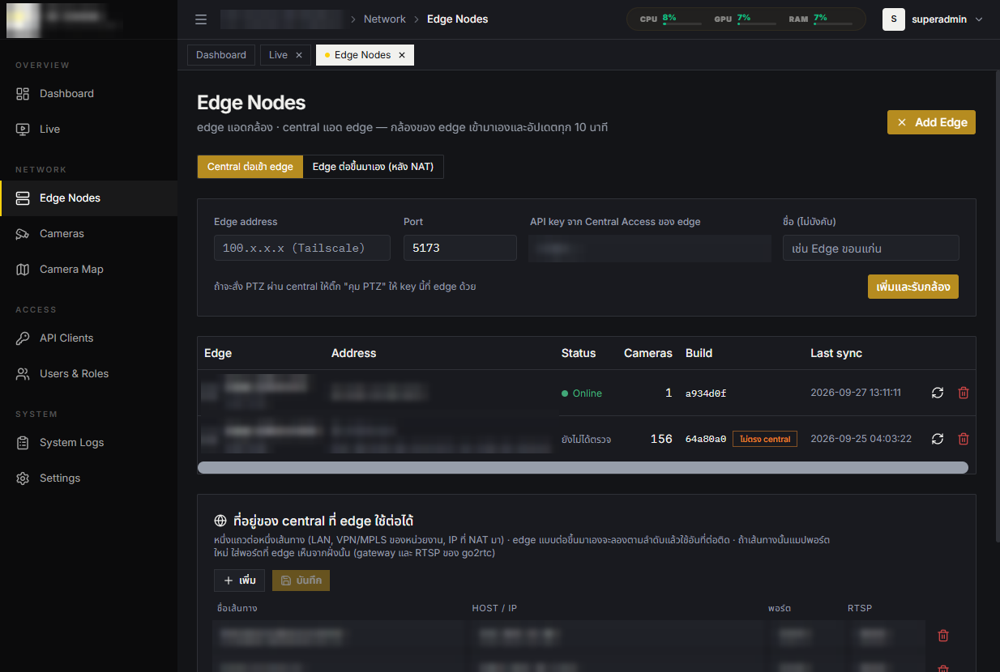

1. At the Edge, issue a key on the Central Access page (section 4.6).
2. At Central press **+ Add Edge** and choose "Central connects into the Edge" (Thai UI "Central ต่อเข้า edge").
3. Enter the Edge's IP, port (Edge 001 = 5273, other Edges = 5173) and the API key, then press **Add and fetch cameras** (Thai UI "เพิ่มและรับกล้อง").
4. Central checks that it is a real Edge and that the number is not a duplicate, then pulls in all of the Edge's cameras.

### Add an Edge by link (the Edge connects up by itself, behind NAT)

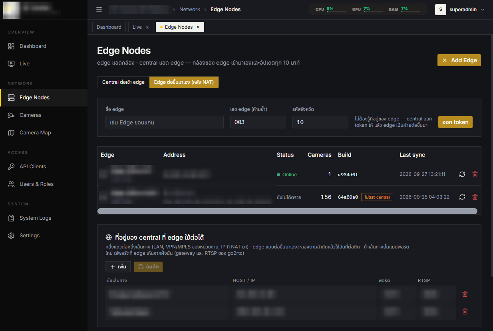

1. Choose "Edge connects up by itself (behind NAT)" (Thai UI "Edge ต่อขึ้นมาเอง (หลัง NAT)"), enter a name, the Edge number (the system suggests the next free number; it must not be duplicated anywhere in the deployment) and the province code.
2. Press **Issue token** (Thai UI "ออก token") and tick the Central routes this Edge can reach.
3. Download the `edge-<number>.json` file to use with the installation kit (Chapter 6). The token is shown only once and is secret.

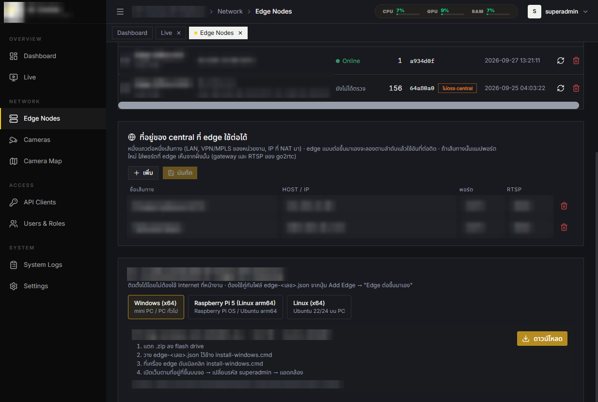

**Central addresses the Edge can use to connect**: enter every route by which the various Edges can see Central (LAN, an organization's VPN/MPLS, a NAT'd IP), together with the gateway and RTSP ports for that route. A link Edge tries them in order.

**Download the Surveillance Gateway Edge installer**: choose Windows (x64), Raspberry Pi 5 (Linux arm64) or Linux (x64). The download link works once, within 5 minutes, and a sha256 is shown so you can verify the file.

### Updating an Edge over the link

When the technical team releases a new version (`build-edge-kit.ps1 -Publish`), a link Edge downloads the signed package by itself. The Edge's row shows "Downloaded" (Thai UI "โหลดแล้ว"); press the arrow button to install (or **Update all**, Thai UI "อัปเดตทั้งหมด"). That Edge's video stops for about 5–10 seconds. If the new version cannot connect to Central within 5 minutes, the Edge rolls back to the previous version by itself.

## 5.2 Cameras

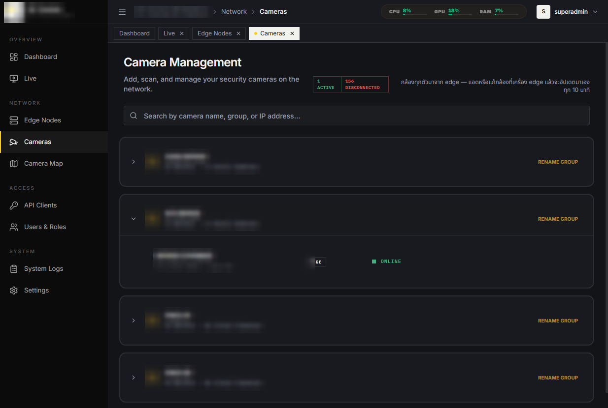

Every camera from every Edge is organized by group. Central owns only the **display group** (groups can be renamed). Name, coordinates, province and enable/disable are edited at the Edge, and Central overwrites them from the Edge on every sync round. A camera deleted at the Edge is deleted here too, while a camera that disappears with no record shows "MISSING AT EDGE" and can be deleted from the "N missing" badge (Thai UI "N หาย") on the Edge Nodes page.

## 5.3 API Clients

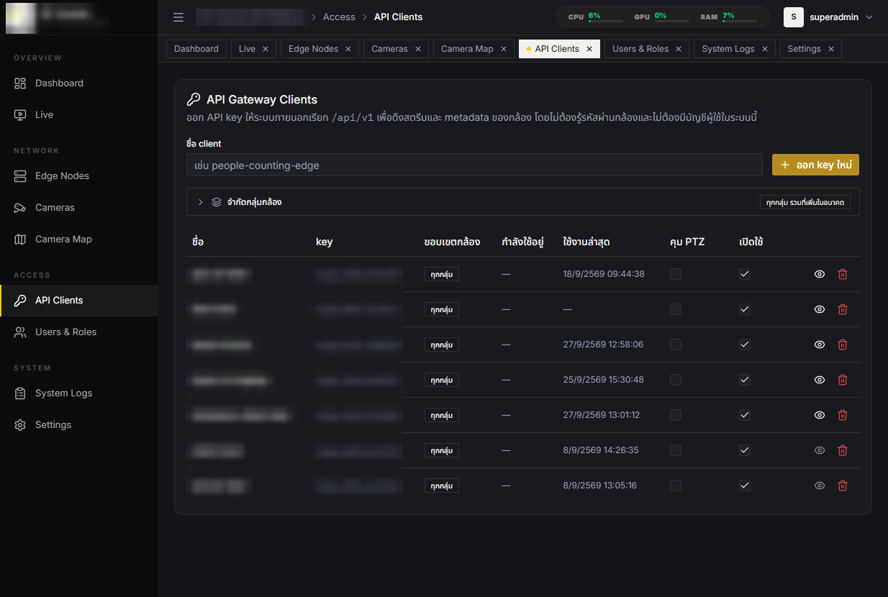

1. Name the client, for example a machine or system name (`people-counting-edge`).
2. Expand **Limit camera groups** (Thai UI "จำกัดกลุ่มกล้อง") if the key should see only some groups (default = all groups).
3. Press **+ Issue new key** (Thai UI "+ ออก key ใหม่") and copy the key to send to the user.
4. Tick **Control PTZ** (Thai UI "คุม PTZ") if the key should be able to move cameras · untick **Enabled** (Thai UI "เปิดใช้") to suspend the key temporarily.

The "In use" column (Thai UI "กำลังใช้อยู่") shows how many machines are using the key. The eye button shows the key again (if the user lost it). The trash button revokes the key immediately.

## 5.4 Users & Roles

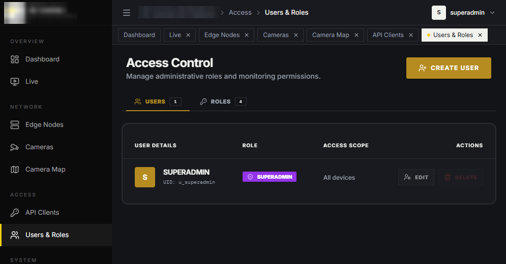

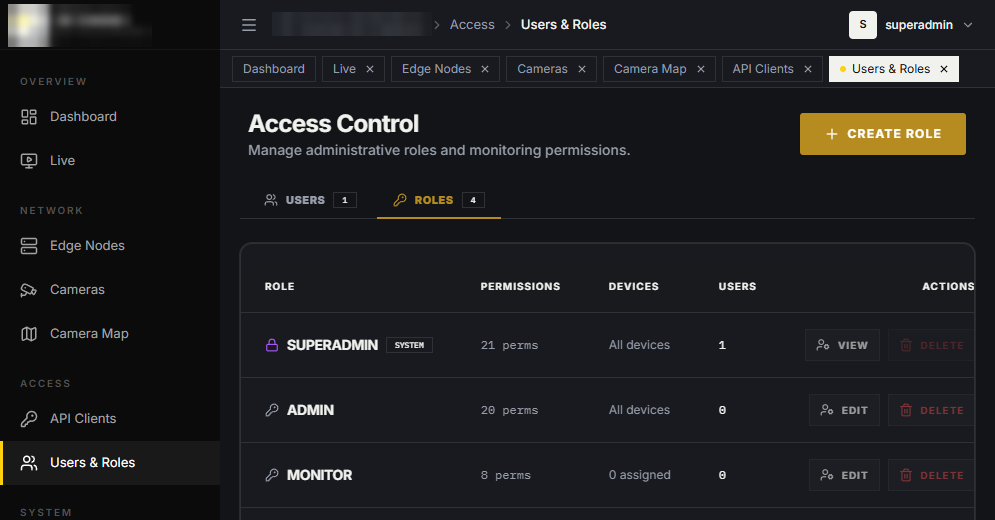

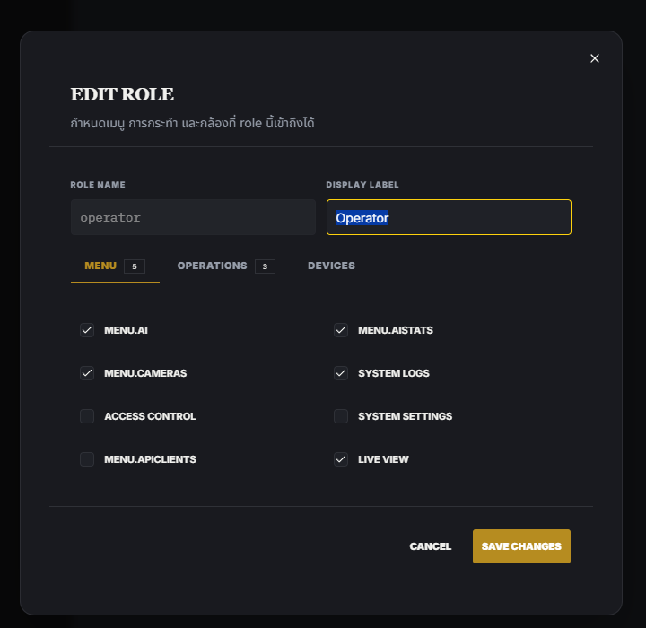

| Role | Permissions in brief | Camera scope |
|---|---|---|
| Monitor | View video (Dashboard, Live) | Only those assigned |
| Operator | View video + manage cameras + see camera credentials + PTZ + view logs | Only those assigned |
| Admin | Everything an Operator has + users/roles + settings + backup/restore + purge logs | All cameras |
| Superadmin | All permissions. A system role that cannot be deleted. | All cameras |

| Key | Meaning |
|---|---|
| `device.manage` | Add, edit, delete and scan cameras, and manage Edges |
| `device.secrets` | See the RTSP and ONVIF account of the cameras the user can see |
| `device.ptz` | Pan, tilt, zoom and use presets from the Live page (everyone watching sees the movement) |
| `user.manage` | Manage users and roles |
| `system.settings` | System and map settings |
| `system.maintain` | Backup, restore, resync and installing Edge updates |
| `log.purge` | Purge logs |

User passwords are stored in the database as scrypt hashes (since 25 Sep 2026). An administrator can set a new password for a user with the Edit button but cannot view the old one.

## 5.5 System Logs

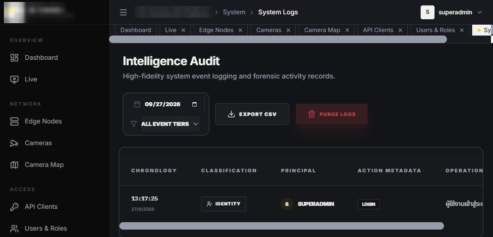

Records system events such as logins, camera adds and deletes, and Edge syncs. You can filter by date and event type and export to CSV. The **Purge Logs** button requires the `log.purge` permission.

## 5.6 Settings

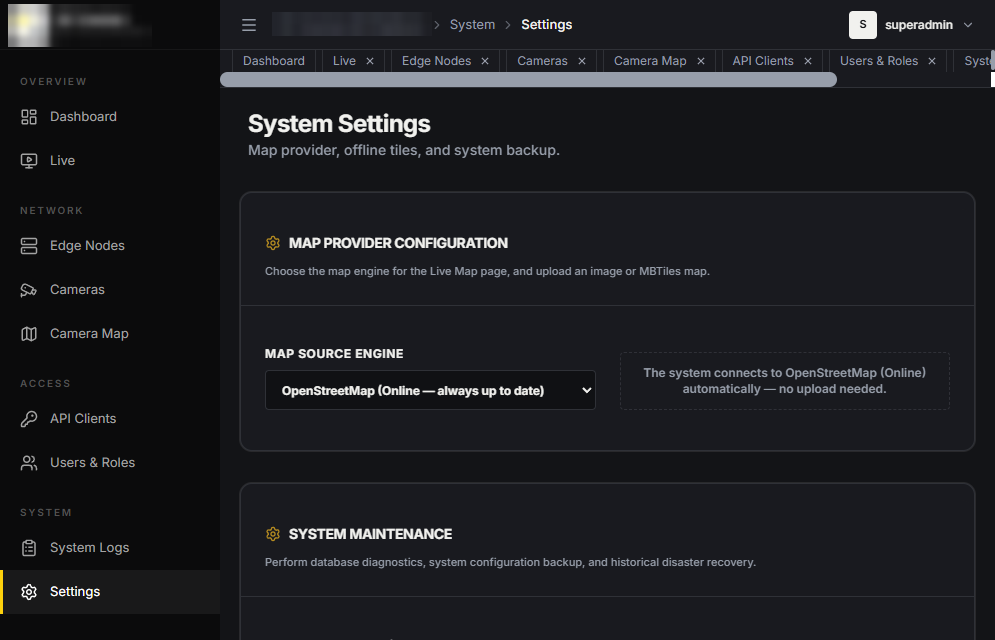

- **Map Provider Configuration**: choose online OpenStreetMap (through Central's proxy and cached to disk) or an MBTiles file for fully offline use.
- **Backup System**: download a copy of the database and the machine's keys.
- **Restore System**: restore from a backup file. The system keeps a copy from before the restore · always restore the database together with the `.gateway-key-secret` from the same backup round.

---

# Chapter 6. Installing a new Edge from a flash-drive kit

The offline installation kit is for sites with no Internet. The kit contains Node.js, ffmpeg and go2rtc. An Edge installed from the kit always connects to Central by link.

| | Windows mini PC | Raspberry Pi 5 / Linux |
|---|---|---|
| Install command | Double-click `install-windows.cmd` (asks for admin rights) | `sudo bash install-linux.sh` |
| Program | `C:\GW-Edge\app`, `C:\GW-Edge\bin` | `/opt/gw-edge/app`, `/opt/gw-edge/bin` |
| Data (DB, secrets) | `C:\GW-Edge\state` | `/var/lib/gw-edge` |
| Start at boot | Scheduled Task **GW Edge** | systemd `gw-edge.service` |
| 02:00 backup | Scheduled Task **GW Edge Backup** | cron `/etc/cron.d/gw-edge-backup` |
| Logs | `C:\GW-Edge\state\logs\` | `/var/lib/gw-edge/logs/` |

1. At Central, on the Edge Nodes page, download the installation kit for the Edge machine's OS (section 5.1). On Windows, extract the `.zip` onto the flash drive; on Linux, use `tar -xzf`.
2. At Central, issue a link token and download `edge-<number>.json`; put it next to the installer or at the root of the flash drive.
3. At the site, run the installer. It writes the machine's settings, creates `go2rtc.yaml` and the RTSP account, starts the system, and then deletes the `edge-<number>.json` file (because it contains the token).
4. Open `http://<Edge IP>:5173/`, sign in as `superadmin` / `superadmin` and **change the password immediately**. Then add cameras.
5. At Central, on the Edge Nodes page, that Edge number must show as Online with a build that matches Central.

**Updating with a flash drive**: run the same installer again with the newer kit; no `edge-<number>.json` file is needed. The installer replaces only `app/` and `bin/`; `state/` (the camera DB and secrets) is not touched.

---

# Part 3. Technical

# Chapter 7. How it works

## 7.1 The 8-step pipeline

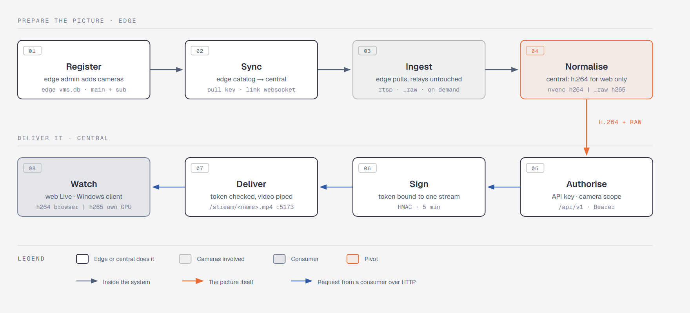

| Step | Where | Details |
|---|---|---|
| 01 Register | Edge | Saves the camera into the Edge's `vms.db`, picks main = stream 1 and sub = stream 2, and issues the global ID. |
| 02 Sync | Edge → Central | Pull: Central reads the Edge's `/api/v1` (health every 60 seconds, sync every 10 minutes) · Link: the Edge sends a `catalog` on connect, every 5 minutes, and whenever something changes. |
| 03 Ingest | Edge | The Edge's go2rtc connects RTSP to the camera when someone is watching and forwards the `_raw` stream unconverted. |
| 04 Normalise | Central | Central's go2rtc produces an H.264 stream (`#video=h264#hardware`, NVENC) for browsers and keeps the `_raw` stream. |
| 05 Authorise | Central | Checks the API key and camera-group scope in SQL. |
| 06 Sign | Central | Issues an HMAC stream token valid for 5 minutes per stream. |
| 07 Deliver | Central | Checks the token at `/stream/<name>.mp4` and relays fMP4 from go2rtc. |
| 08 Watch | Viewer | The browser plays H.264 · the Windows Client plays `_raw` with libVLC and the machine's GPU. |

## 7.2 Why the Edge does not transcode

- go2rtc 1.9.14 crashes when it sends H.265 out over MSE, so the stream a browser plays must be H.264, but only for streams someone has opened on the web.
- The Windows Client can decode H.265 itself, so it takes the `_raw` stream and the server does not need to transcode for every viewer.
- An Edge may be a small machine with no GPU. Moving transcoding to Central (RTX GPU) makes it possible to use a Raspberry Pi 5 as an Edge.
- go2rtc's HLS is unusable (the segments are audio only), so the system plays through fMP4 at `/stream/<name>.mp4`.

## 7.3 The link between Edge and Central

The Edge opens a WebSocket to `ws://<central>:5173/api/edge-link` with a token that Central issued (Central stores only its hash). Messages are one JSON object per frame.

| Direction | Messages |
|---|---|
| Edge → Central | `hello` · `heartbeat` every 20 seconds · `catalog` · `camera_state` · `update_status` · `reply` |
| Central → Edge | `welcome` · `rpc` (`catalog.push`, `stream.open`, `stream.close`, `ptz.info`, `ptz.cmd`, `update.apply`) · `update` |

- Silent for more than 60 seconds = the link is dead · an Edge number that duplicates Central or another Edge is rejected.
- Video: Central creates a waiting stream `<id>_in`. When someone opens the camera, Central sends `stream.open` and the Edge's ffmpeg pushes (`-c copy -an`) up to Central's RTSP. With no viewer for more than 60 seconds it sends `stream.close`.
- The Edge tries Central's addresses in order and pushes video to the host of the address that connected.

## 7.4 The three-valued camera status

Every machine keeps status in one place (`server/shared/camera-state.js`) and notifies listeners immediately when a value changes. It is exposed through `/api/v1/cameras[].state` and the SSE stream `/api/v1/events`.

- **enabled** comes from `cameras.enabled` at the Edge. When disabled, the camera is removed from go2rtc.
- **reachable**: the Edge checks TCP to the RTSP port every 15 seconds. For Edge cameras, Central uses the value the Edge reports; if the Edge cannot be reached the value is `null` (unknown), not `false`.
- **streaming** comes from a producer that is actually connected in go2rtc (do not use `streams.*.ready`, because it stays true even when the camera is unplugged).

## 7.5 Signed Edge updates

`build-edge-kit.ps1 -Publish` builds a package per platform with a manifest signed with ed25519. The Edge verifies the signature against the public key shipped with the installation kit, downloads over the link, checks the sha256, and then waits for someone to press install. The `edge-run` supervisor swaps the `app` and `app.prev` folders and rolls back by itself if the new version cannot connect to Central within 5 minutes.

> **Important:** The signing key `D:\gw-edge-kits\signing\edge-update-key.pem` must never be lost and must never go into git. If it is lost, no Edge will accept new packages until it is updated with a flash-drive kit that contains the new public key.

---

# Chapter 8. Backend and operations

## 8.1 Components

| Part | Technology |
|---|---|
| Backend | Node.js + Express (CommonJS), SQLite (`sqlite3`), no ORM. Main file `server/server.js`. |
| Streaming core | go2rtc 1.9.14 + ffmpeg (NVENC on the RTX GPU at Central) |
| Web UI | React + Vite + shadcn/ui, built into `dist/`, shared by Central (`index.html`) and Edge (`edge.html`) |
| Windows Client | .NET 8 WPF + libVLC + WebView2; updates through Velopack from `/client-updates` |
| Process supervisor | pm2 on the Central machine (also Edge 001) · `edge-run.cjs` on kit-installed Edges · systemd + pm2-runtime on Edge 002 (Ubuntu) |

## 8.2 Ports and processes on the Central machine

| pm2 app | Role | Port |
|---|---|---|
| `2-vms-backend` | Surveillance Gateway Central | 5173 |
| `0-go2rtc` | Central's go2rtc | 1984 API · 8555 RTSP · 8556 WebRTC |
| `3-edge-gateway` | Surveillance Gateway Edge (Edge 001) | 5273 |
| `1-go2rtc-edge` | Edge 001's go2rtc | 1994 · 8565 · 8566 |

At boot, the Scheduled Task "CCTV Gateway (pm2 resurrect at boot)" runs `scripts/start-gateway.cmd`, which starts the apps from `ecosystem.windows.config.cjs` and `ecosystem.edge.config.cjs` in git (it does not use `pm2 save`).

## 8.3 Restart and deploy

> **Important:** The repo `D:\gateway-dashboard` is what actually runs. Edit a file and restart, and it is live immediately · pm2 must be run only from a PowerShell opened with Run as administrator. An ordinary shell will create a new empty daemon.

| What you changed | What to do next |
|---|---|
| `server/**` | `node --check` → restart `2-vms-backend 3-edge-gateway` → check `/api/instance` to see that the build is the new commit |
| `src/**` | `npm run build` (no restart needed). If it uses a new API, restart the backend first. |
| `client-windows/**` | Bump `<Version>` in the csproj → `scripts\build-client-release.ps1` → commit |
| Releasing a version to Edges | commit → restart Central → `scripts\build-edge-kit.ps1 -Publish` (admin shell) → press update on the Edge Nodes page |
| `ecosystem.*.config.cjs` | `pm2 delete <app>` then `pm2 start <ecosystem> --only <app>` |

Restart command (admin PowerShell):

`$env:PM2_HOME="C:\Users\Administrator\.pm2"; & "C:\Users\Administrator\AppData\Roaming\npm\pm2.cmd" restart 2-vms-backend 3-edge-gateway`

Check after the restart: `curl http://203.0.113.10:5173/api/instance` and `:5273/api/instance`

## 8.4 Testing without touching production

Use `scripts/edge-sim.ps1` to start a simulated Edge (5283) and a test Central (5383) with their own go2rtc. If you start `server.js` yourself for testing, you must set `GATEWAY_STATE_DIR`, `GATEWAY_PORT` and **point `GO2RTC_API_PORT` / `GO2RTC_RTSP_PORT` somewhere else**. Otherwise the test instance will sync over and delete the real go2rtc's streams.

---

# Chapter 9. Security

| Topic | How the system handles it |
|---|---|
| Camera passwords | Live only at the Edge and never leave through `/api/v1` (queries use a column whitelist). Visible only to users with the `device.secrets` permission. |
| Web user passwords | Stored as scrypt hashes (`server/shared/password.js`). Old plaintext rows are converted automatically at startup or at login. |
| API keys | Verified by key hash · the copy used for viewing again, and the key Central holds with an Edge, are encrypted with `.gateway-key-secret`. |
| stream token | HMAC bound to a single stream, valid for 5 minutes, using `.stream-token-secret`. |
| Link-Edge token | Central stores only a hash and shows the token once. |
| Edge updates | Packages signed with ed25519. The Edge verifies the signature before installing. |
| Encryption in transit | **There is no TLS yet.** The web, API, RTSP and link all run in the clear and may be used only inside a LAN or a VPN (Tailscale). Never expose them directly to the Internet. |

## Recommendations for closed-network use

- Change the `superadmin` password on every machine immediately after installation.
- Open the firewall for ports 5173, 5273 and 8555 only to the IP ranges actually in use. The go2rtc API (1984/1994) should not be open to the LAN.
- Across sites, use Tailscale, which already encrypts with WireGuard.
- State files (`vms.db*`, `.gateway-key-secret`, `.stream-token-secret`, `.rtsp-credentials.json`, `go2rtc.yaml`, `backups/`) must never go into git.

---

# Chapter 10. Backup and restore

| Data | In git | Back up with |
|---|---|---|
| Code | Yes (the repo on this machine has no remote) | git |
| `server/vms.db` (Central) | No | `backup-windows.ps1` |
| `D:\gateway-edge\vms.db` (Edge 001) | No | `backup-windows.ps1` |
| Secrets on both machines | No | `backup-windows.ps1` |
| Edge update signing key | No | `backup-windows.ps1` |

- The Scheduled Task **CCTV Backup (nightly)** runs daily at 02:00 and stores to `D:\gateway-backups\daily\<yyyyMMdd-HHmmss>\{central,edge}\`. It keeps 30 days but always keeps at least the 3 most recent rounds.
- `.\backup-windows.ps1 -List` shows the available rounds · a failed backup returns exit code 1 (see Task Scheduler).
- The backup is on the same disk as the live data. It protects against mistakes but not against disk failure. Periodically copy `D:\gateway-backups` and `D:\gw-edge-kits\signing` to storage outside the machine.

## Database restore procedure

1. Stop the app to be restored (`pm2 stop 2-vms-backend` or `3-edge-gateway`) from an admin shell.
2. Delete that machine's `vms.db-wal` and `vms.db-shm` files.
3. Place `<round>\central\vms.db` (or `edge\vms.db`) as `vms.db`, together with the secrets from the same folder.
4. `pm2 start` that app.

> **Important:** Always restore `vms.db` together with the `.gateway-key-secret` from the same round, because the keys in the database are encrypted with that secret.

---

# Chapter 11. Troubleshooting

| Symptom | What to check |
|---|---|
| The menu is empty, only Dashboard is left | The user has no role or permissions · sign out and sign in again. |
| The web UI is old, new buttons do not appear | `npm run build` was forgotten, or the browser cache is stale. Press Ctrl+F5. |
| A new API answers 404 | The backend was not restarted. Check the build in `/api/instance`. |
| An Edge camera shows "unknown status" | Central cannot reach the Edge. See the latest error on the Edge Nodes page. |
| Central does not see a camera just added at the Edge | Wait for the sync round (pull 10 minutes, link 5 minutes) or press Sync on the Edge Nodes page. |
| A link Edge shows "unreachable" | Check the Edge's log for `[Edge link]` lines · wrong token = 401 · duplicate Edge number = Central rejects it. |
| A link camera opens to a black screen | The Edge must be able to reach Central's RTSP port 8555 · check the Edge's log for push lines. |
| Video appears tens of seconds late | The sub stream's I-frame interval is too long. Set it at the camera to ≈ fps · old cameras may still use stream 3 (section 4.4). |
| The camera connects but the screen is black (audio only) | Some NVR models cut the video when a backchannel is requested. The system already sends `#backchannel=0`; see `docs/CAMERA-QUIRKS.md`. |
| The Live menu is missing / PTZ is refused | The role needs `menu.live` / `device.ptz` · for Edge cameras, "Control PTZ" must also be ticked on the Edge's Central Access page. |
| pm2 commands have no effect | The shell is not elevated. Open an admin PowerShell and close the new empty daemon that was created. |
| The map is blank | Central must be able to reach the Internet (tiles go through the proxy and cache), or switch to MBTiles on the Settings page. |
| The Client shows a build-mismatch banner | The Edge's build does not match Central's. Update the Edge on the Edge Nodes page. |

---

# Appendices

## A. Public API /api/v1

Every request carries the header `Authorization: Bearer sgw_…`. Results are filtered by the key's camera-group scope.

| Endpoint | Purpose |
|---|---|
| `GET /api/v1/health` | Role (`central`/`edge`), machine number, build · Central attaches `edges[]` for comparing versions |
| `GET /api/v1/cameras` | Camera list with `globalId`, `region`, `origin`, `enabled`, `state` |
| `GET /api/v1/cameras/:id/streams` | Main/sub stream URLs (`mp4`, `mp4Raw`, RTSP) with a stream token |
| `GET /api/v1/cameras/:id/snapshot` | Latest still image |
| `GET/POST /api/v1/cameras/:id/ptz` | PTZ capabilities / send a PTZ command (the key needs the PTZ permission) |
| `GET /api/v1/events` | SSE live status `camera_state` (and `camera_status` for older Clients) |
| `GET /api/v1/cameras/deleted` | List of cameras deleted at the Edge (Central uses it to delete in step) |
| `GET /api/instance` | The machine's role and build; no login needed |

## B. Reference documents in the repo

| File | Contents |
|---|---|
| `README.md` | Overview, machines and ports, first-time use |
| `agents.md` | Rules for changing code and the pitfalls already encountered |
| `context.md` | The reasoning behind the design, and technical debt |
| `docs/OPERATIONS.md` | Restart, deploy, backup, logs, troubleshooting |
| `docs/EDGE-PLAN.md` | The Edge-to-Central relationship and the link |
| `docs/EDGE-KIT.md` | The Edge installation kit and updating over the link |
| `docs/EDGE-LINUX.md` | Setting up an Edge on Ubuntu the original way (Edge 002) |
| `docs/CAMERA-QUIRKS.md` | Brand-specific camera problems |
| `docs/CLIENT-RELEASES.md` | Releasing a Windows Client version |
| `docs/workflow.html` · `architecture.html` · `pipeline.html` | The diagrams used in this guide |

## C. About this guide

All screenshots were taken from the live system on 27 Sep 2026 (Central build a934d0f, Client 1.7.2 and 1.7.4). Edge 002 was offline while they were taken, so the online-camera counts in the images are lower than normal.

powered by Warapon Wichitpan
